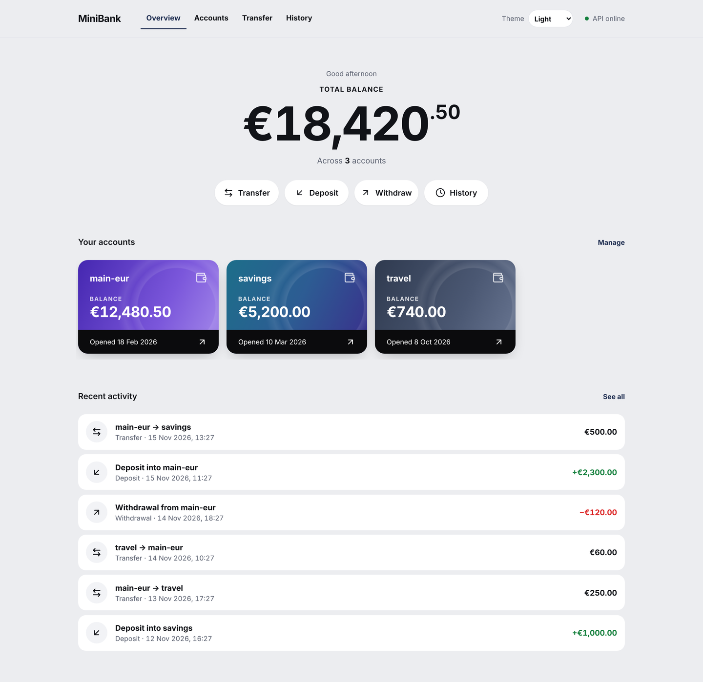
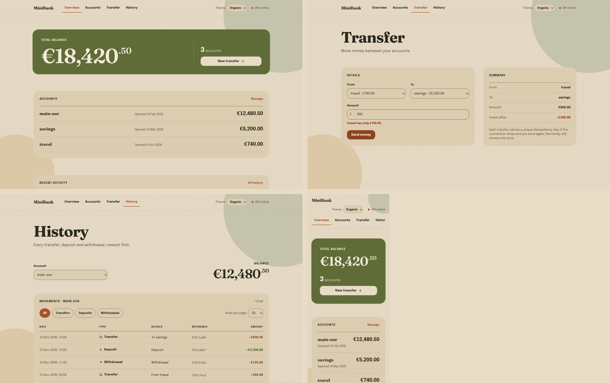
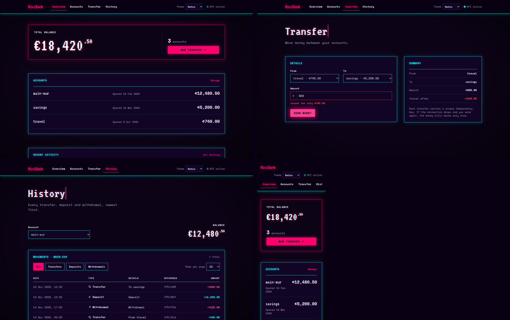

# MiniBank API


A concurrency-safe banking app: **Spring Boot 4 + PostgreSQL** API with a **React** frontend.



## Features
- Accounts: create, get, list (paged)
- Deposits and withdrawals
- Money transfers with **idempotency keys** (safe retries - money never moves twice)
- **Deadlock-free locking**: database row locks (`SELECT ... FOR UPDATE`) taken in a fixed order, plus `@Version` optimistic locking as a safety net
- Transaction history, newest first (paged)
- Consistent JSON errors with correct HTTP status codes
- Swagger UI, health check, CORS for a frontend

## Tech stack
| Area | Tools |
|---|---|
| Backend | Java 17+, Spring Boot 4, Spring Web MVC, Bean Validation |
| Data | PostgreSQL 16, Spring Data JPA (Hibernate), Flyway migrations |
| Docs | springdoc-openapi (Swagger UI) |
| Tests | JUnit 5, MockMvc, Testcontainers (real PostgreSQL) |
| Frontend | React 19, TypeScript, Vite, Tailwind CSS 4, TanStack Query, React Router, Vitest |
| DevOps | Docker, docker-compose, nginx, GitHub Actions |

## Run

### Option 1 - everything in Docker (easiest)
```bash
docker compose up --build
```

### Option 2 - database in Docker, app from your IDE / terminal
```bash
docker compose up -d db
./mvnw spring-boot:run          # Windows: .\mvnw.cmd spring-boot:run
```

Then open:
- **App: http://localhost:3000**
- API: http://localhost:8080/api/v1/accounts
- Swagger UI: http://localhost:8080/swagger-ui.html
- Health: http://localhost:8080/actuator/health

### Frontend dev server (hot reload)
```bash
docker compose up -d db app     # backend
cd frontend
npm install
npm run dev                     # http://localhost:5173 (proxies /api to :8080)
```

### Run tests
Docker must be running (Testcontainers starts a real PostgreSQL):
```bash
./mvnw verify
```

## Frontend
Five switchable themes (header menu, saved in the browser, or `?theme=light|aurora|organic|retro|swiss` in the URL). Each one is a complete design direction with its own palette, fonts, shapes, texture and motion:

| Theme | Look | Motion |
|---|---|---|
| **Light** (default) | Soft grey page, white pill buttons, two-tone account cards, transactions as cards, Send money screen with keypad (Inter) | Lift on hover, page and row entrances |
| **Aurora** | Black with lightning-green (#B8FF2C) glow, glass cards, green gradient account cards (Inter) | Drifting green light, spring page and list entrances, lift on hover |
| **Organic** | Sand and earth tones, moss balance card, rounded cards, paper grain (Fraunces + Epilogue) | Slow "breathing" balance card and background shapes, gentle easing |
| **Retro** | Synthwave terminal: black, magenta + cyan neon, scanlines, grid floor (VT323 + Space Mono) | Typewriter page titles, blinking caret, stepped entrances, moving grid |
| **Swiss** | White, one sans family, Klein Blue, hairline rules | Rules draw in, quiet fades |

All themes: balances count up when they change, pages and table rows animate in, and everything is switched off for users with *reduce motion* turned on. Fonts are bundled with the app (no Google Fonts requests).

| Page | What it does |
|---|---|
| Overview | Total balance, all accounts, latest movements across accounts |
| Accounts | Open an account; deposit / withdraw inline with a live new-balance preview |
| Transfer | From / To / Amount with validation; sends an `Idempotency-Key` so retries are safe |
| History | Per-account movements, type filter, page size, pagination (state kept in the URL) |

Also: live API status (`/actuator/health`), keyboard focus styles, labelled form errors, reduced-motion support, mobile layout.

| Organic | Retro |
|---|---|
|  |  |

## Endpoints (`/api/v1`)

| Method | Path | Description |
|---|---|---|
| POST | `/accounts` | Create account `{ "id": "A", "initialBalance": 1000 }` |
| GET | `/accounts?page=0&size=20` | List accounts |
| GET | `/accounts/{id}` | Get one account |
| POST | `/accounts/{id}/deposit` | Deposit `{ "amount": 50 }` |
| POST | `/accounts/{id}/withdraw` | Withdraw `{ "amount": 20 }` |
| GET | `/accounts/{id}/transfers?page=0&size=20` | History, newest first |
| POST | `/transfers` | Transfer `{ "fromId": "A", "toId": "B", "amount": 100 }` + optional `Idempotency-Key` header |
| GET | `/transfers/{id}` | Get one transfer |

## Error format
```json
{ "status": 422, "code": "INSUFFICIENT_FUNDS", "message": "Insufficient funds in account: A", "timestamp": "..." }
```

| Status | When |
|---|---|
| 400 | Invalid input, malformed JSON, bad query parameter |
| 404 | Account / transfer / route not found |
| 405 | Wrong HTTP method |
| 409 | Duplicate account, or `Idempotency-Key` reused for a different request |
| 422 | Insufficient funds |

## How idempotency works
1. The client sends `Idempotency-Key: <unique value>` with a transfer.
2. The key is saved **in the same database transaction** as the money movement, as a primary key.
3. Same key again -> the stored result is returned, no money moves.
4. Two requests with the same key **at the same moment** -> the second one fails on the primary key, its transaction (including the money) is rolled back, and it returns the first result.
5. Same key with a different amount or accounts -> `409 Conflict`.

## Project structure
```
config/      CORS + OpenAPI setup
controller/  REST endpoints
dto/         Request / response records
error/       Custom exceptions + global error handler
model/       JPA entities (Account, Transfer, IdempotencyRecord)
repository/  Spring Data repositories
service/     Business logic, transactions, locking
resources/db/migration/  Flyway SQL migrations
frontend/    React app (src/api, src/components, src/pages)
```
